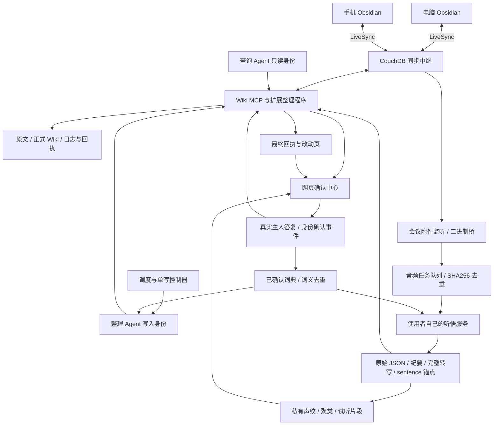

# 系统总图：什么存在哪里，谁负责什么

## 数据怎样走

图中箭头说明逻辑连接，不表示启动基础 Compose 后所有服务都已经存在。

## 三种“正本”

- **原始资料正本**：原始笔记、音频、原始识别 JSON。保留原件与 hash，重跑分析不冒充重跑语音识别。
- **知识正本**：Wiki 当前页与历史来源。允许核证更新，保留旧结论适用条件、原话和历史。
- **运行状态正本**：服务自己的任务数据库、提交 journal、回执、确认卡和事件日志。不能靠文件修改时间推断一个任务已完成。

服务器上的 CouchDB 接收各端同步。桌面和手机都有自己的本地副本。Agent 在服务器读写并不要求电脑一直开机，但需要中继、MCP 和 Agent 运行服务在线。手机操作系统的后台限制独立存在；服务在线不能保证手机 App 在后台持续传输。

## 需要区分的中继

| 名称 | 用途 | 不承担什么 |
|---|---|---|
| CouchDB + LiveSync | 笔记、附件、删除/冲突状态的复制 | 理解资料、生成知识、确认人物 |
| HTTPS 反向代理 | TLS、域名、转发到内部服务 | 自动赋予应用权限 |
| MCP | Agent 读取、投稿、整理工具 | 同步手机本地 App 的后台运行 |
| Agent 平台 / 模型接口 | 运行任务和调用模型 | 替代 Wiki 的来源和提交台账 |
| 会议接收器 | 上传、签名音频 URL、异步任务轮询 | 没有授权时把音频送给外部服务 |

作者其他远程电脑/聊天中继并不是 Wiki 同步的必要依赖，因此不发布它们的连接配置。公开版可以在一台服务器合并服务，也可以拆成两台；无论哪种部署，只有一个正式知识写入协调入口。

## 知识如何“自生长”

自生长是受约束的循环：新增来源 → 读齐内容 → 对照已有主题 → 有证据地更新 → 发现疑问 → 先查库内/外部 → 必要时请主人确认 → 采纳与回执 → 再巡检。不是让 Agent 自动编造新事实或反复把自己的输出当新来源。

结构程序控制路径、身份、版本、锁、幂等和回读；模型负责语义判断。两者都通过才有业务验收。结构 PASS 不证明原话、数字、日期和观点归属正确。
